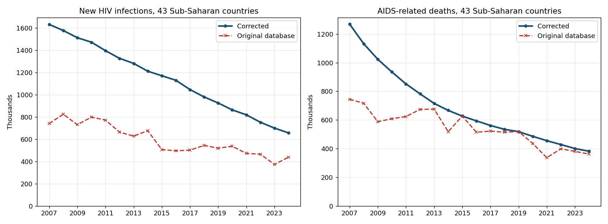
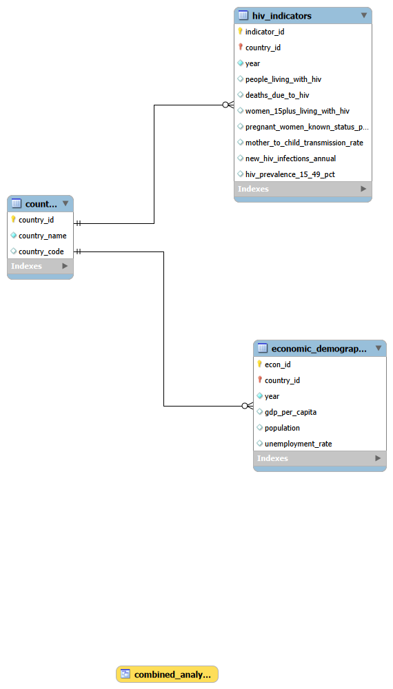

# HIV Trends in Sub-Saharan Africa, 2007-2024: R, MySQL, and Tableau

A MySQL database that combines UNAIDS HIV estimates with World Bank economic data for 49 Sub-Saharan African countries from 2007 to 2024. R scripts reshape the World Bank export, SQL loads and pivots the UNAIDS data, and Tableau dashboards show seven HIV indicators over time.

**Tech:** R (tidyverse), MySQL 8.0, MySQL Workbench, Tableau

**Live dashboard:** [HIV Trends in Sub-Saharan Africa on Tableau Public](https://public.tableau.com/app/profile/rabiat.blessing.ibrahim/viz/Sub-SaharanAfricaHIVTrends2007-2024/HIVTrendsinSub-SaharanAfrica)

**Sources:** [UNAIDS AIDSinfo](https://aidsinfo.unaids.org/) for HIV estimates, and the [World Bank World Development Indicators](https://databank.worldbank.org/source/world-development-indicators) for GDP per capita, population, unemployment, and HIV prevalence

## Team

A group project for ITC6000: Database Management Systems at Northeastern University (Vancouver), completed in November 2025 by Rabiat Blessing Ibrahim, Jennifer Flora Bastian, Thaise Gusson Silva Domingos, and Stella Kafui Sabuki.

The data quality review and corrected build in this repository were added by Rabiat Blessing Ibrahim in 2026.

## What the data shows



Across the 43 countries that report both measures every year:

- **New HIV infections fell 60%**, from 1.63 million in 2007 to 656,000 in 2024.
- **AIDS-related deaths fell 70%**, from 1.27 million to 382,000.
- **The decline was not universal.** New infections rose in 5 of 43 countries (Cabo Verde, Congo, Madagascar, Senegal, and Sudan), and deaths rose in Madagascar and Sudan. Madagascar stands out, with new infections up 357% over the period.

## Fixing the data

The original database gave a misleading picture of these trends. Comparing every value in it against the UNAIDS source turned up two problems.

**116 values were 100 times too small.** In the wide-format file used to load the database, 78 new-infection values and 38 death values had lost two zeros, and all of them were exact multiples of 10,000 in the source. Nigeria's 2016 new infections showed as 1,000 instead of 100,000, and Zimbabwe's 2007 deaths as 1,100 instead of 110,000. The dashed red lines in the chart above show the effect: the original data understated 2007 new infections by more than half and turned a steady decline into a jagged line.

**Six countries were split across two rows per year.** UNAIDS and the World Bank spell some country names differently (for example "Côte d'Ivoire" and "Cote d'Ivoire," or "Democratic Republic of the Congo" and "Congo, Dem. Rep."). For Congo, the Democratic Republic of the Congo, Côte d'Ivoire, Gambia, Somalia, and Tanzania, the HIV figures and the prevalence figures ended up in separate rows. The table held 918 rows instead of 810, and the extra half-empty rows inflated the missing-data rates in the original report.

**The fix.** `sql/01_build_database.sql` now loads the long-format UNAIDS file directly and pivots it to one row per country and year in SQL:

- A `country_name_map` table resolves the six name pairs to one spelling.
- Values like `100000,00` use a comma as the decimal mark, so the comma is replaced before casting.
- Entries that aren't numbers, such as `...`, become NULL instead of being cast to zero.
- A `UNIQUE (country_id, year)` key blocks duplicate rows.
- Validation queries check three known values, confirm one row per country and year, and compare every loaded death and new-infection value against its source. All return the expected results.

## Database design



| Table | Rows | Contents |
| --- | --- | --- |
| `country` | 49 | Country name and ISO code |
| `hiv_indicators` | 810 | Seven UNAIDS and World Bank HIV measures per country and year |
| `economic_demographic` | 882 | GDP per capita, population, and unemployment per country and year |
| `combined_analysis` (view) | 810 | Both tables joined, plus people living with HIV as a share of population |

The build processes 8,347 source values: 5,701 HIV indicator values from UNAIDS and the World Bank, and 2,646 World Bank economic values. UNAIDS publishes no estimates for Equatorial Guinea, Mauritius, Sao Tome and Principe, or Seychelles in this data, so those four countries have economic rows but no HIV rows.

## HIV and the economy

HIV prevalence among adults aged 15 to 49 rises with both income and unemployment:

| GDP per capita | Countries | Country-years | Avg. HIV prevalence |
| --- | --- | --- | --- |
| Under $1,000 | 30 | 374 | 3.29% |
| $1,000 to $2,000 | 26 | 220 | 4.12% |
| $2,000 to $5,000 | 12 | 126 | 6.70% |
| Over $5,000 | 6 | 65 | 13.20% |

| Unemployment rate | Countries | Country-years | Avg. HIV prevalence |
| --- | --- | --- | --- |
| Under 5% | 28 | 406 | 2.71% |
| 5% to 10% | 16 | 131 | 4.49% |
| 10% to 20% | 15 | 184 | 5.72% |
| Over 20% | 7 | 86 | 13.04% |

These patterns come mostly from geography rather than from income or unemployment themselves. Southern African countries such as South Africa, Botswana, and Namibia have both the region's highest incomes and its highest unemployment, and they also carry the heaviest HIV burden. The tables show that these measures move together, not that one causes another.

## Dashboards

The [Tableau dashboard](https://public.tableau.com/app/profile/rabiat.blessing.ibrahim/viz/Sub-SaharanAfricaHIVTrends2007-2024/HIVTrendsinSub-SaharanAfrica) charts seven indicators by year: people living with HIV, women 15+ living with HIV, new infections, deaths, mother-to-child transmission rate, pregnant women with known HIV status, and HIV prevalence. It reads `data/clean/combined_analysis.xlsx`, which has the same columns and sheet name as the original export, so the dashboards update by pointing the workbook at the corrected file.

## Repository layout

```
sub-saharan-hiv-analysis/
├── README.md
├── r/
│   ├── 01_clean_worldbank.R          World Bank export to long format
│   └── 02_build_economic_table.R     Long format to one row per country and year
├── sql/
│   ├── 01_build_database.sql         Schema, import, pivot, validation, view
│   └── 02_analysis_queries.sql       Trends, country changes, economic bands
├── data/
│   ├── raw/
│   │   ├── hiv_indicators_long.csv   UNAIDS and World Bank HIV values, long format
│   │   ├── economic_demographic.csv  World Bank economic values (from the R scripts)
│   │   ├── worldbank_data.csv        Original World Bank export
│   │   └── unaids/                   Original UNAIDS exports, one file per indicator
│   └── clean/
│       ├── hiv_indicators.csv        Corrected HIV table
│       ├── combined_analysis.csv     Corrected combined view
│       └── combined_analysis.xlsx    Same data, for Tableau
└── docs/
    ├── erd.png
    └── regional_trends_corrected_vs_original.png
```

## How to run

1. Run `r/01_clean_worldbank.R`, then `r/02_build_economic_table.R`, from the repository root. This step is optional, since `data/raw/economic_demographic.csv` is already included.
2. In MySQL Workbench, run `sql/01_build_database.sql` down to section 3, which creates the tables.
3. Import the two CSV files into the staging tables with the Table Data Import Wizard, following the column mapping in section 3.
4. Run the rest of the script. The validation queries in section 7 should match the expected values in the comments.
5. Run `sql/02_analysis_queries.sql`.

## Limitations

- UNAIDS figures are modeled estimates with uncertainty ranges. This database stores the central estimate only.
- UNAIDS reports small values as ranges like "<100." For Comoros, these are stored as 100, an upper bound.
- Pregnant women with known HIV status is missing for 184 of 810 country-years (23%), and the mother-to-child transmission rate for 73 (9%), so trends for those measures cover fewer countries.
- Zambia has no estimate for people living with HIV, Liberia and Somalia have gaps in new infections, and Somalia has gaps in deaths.
